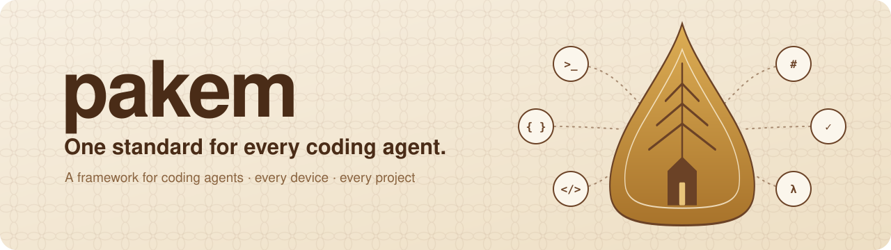
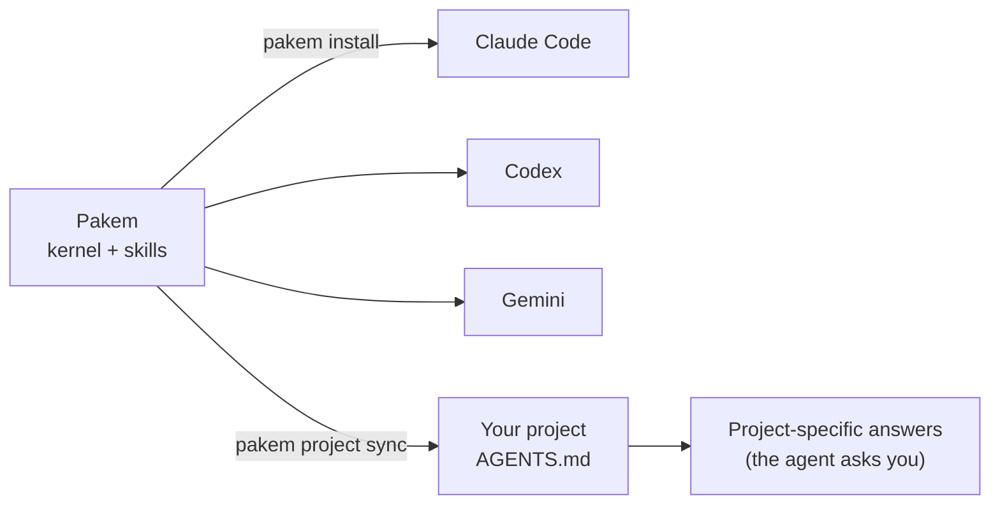

<p align="center">
  <picture>
    <source media="(prefers-color-scheme: dark)" srcset="docs/assets/banner-dark.svg">
    
  </picture>
</p>

<p align="center">
  <b>A framework for coding agents.</b> One set of rules, skills, and automation for Claude Code,
  Codex, and Gemini, on every device and in every project.
</p>

<p align="center">
  <a href="#install">Install</a> ·
  <a href="#what-you-get">Features</a> ·
  <a href="#commands">Commands</a> ·
  <a href="#how-it-works">How it works</a> ·
  <a href="#roadmap">Roadmap</a>
</p>

---

## Tired of teaching your coding agents the same rules on every project?

You open a new project and explain it all again: how you commit, when to open a pull
request, that secrets never get printed, that production needs your say. Then a second
agent on another machine does it a little differently. A week later one of them has
forgotten half of it.

**Pakem gives every coding agent you use the same standard, once.** Install it on a
device and every agent there (Claude Code, Codex, Gemini) starts each session knowing
your rules, your workflow, and the skills to apply them. Adopt a project and it carries
that standard in its own files, so every agent that opens it, on any machine, works the
same way.

> **Why "Pakem"?** In Javanese wayang, the *pakem* is the canonical story every
> *dalang* (puppeteer) follows, while each performance still improvises its own scenes.
> Pakem does the same for your coding agents: one shared standard, and room for each
> project to be itself.

## What you get

- **One kernel for every agent.** A short, versioned set of rules installed into each
  agent's own instructions file, so Claude Code, Codex, and Gemini follow the same
  standard.
- **Floors that never bend.** Secrets are never printed, production changes only on
  your word, nothing the agent did not create is deleted without asking, and an agent
  never merges its own work.
- **Free by default.** Agents use only free services and tiers; a project approves any
  paid service, with its budget, in its own `AGENTS.md`.
- **Skills for real work.** Debugging, planning, backend, UI, GenAI, releases, reviews,
  handoffs, sensitive operations. Each is loaded only when the task needs it.
- **Plans you agree on first.** Specs are written with you, approved in the session, and
  shipped with the code in one pull request once you accept the result.
- **Interviews that end.** When a project needs answers only you have, the agent asks
  them in one batch with defaults, follows up once at most, and records what is still
  pending instead of guessing.
- **Projects that stay in sync.** Each project pins the standard it follows; `pakem
  project check` and a weekly drift report show what is out of date.
- **Live updates.** After you update Pakem, type `/pakem-update` in a running session: the
  agent re-reads the new rules, tells you what changed, and aligns its project (fixing
  its own, proposing in shared ones, never refactoring on its own).
- **Guardrails, not just advice.** Optional hooks block risky commands per agent, and git
  hooks keep commit messages consistent.
- **A deployment standard.** One release engine per server: signed releases, backups
  before migrations, health checks that prove the running version, automatic restore,
  notifications.
- **Honest by design.** Agents report what passed, what failed, and what they did not
  run. Your coding friend, but a frank one.

## Install

```sh
curl -fsSL https://raw.githubusercontent.com/alfonsusenrico/pakem/main/install.sh | sh
```

The installer:

1. checks for `git` and Python 3.11 or newer, and tells you how to get them if missing;
2. downloads the latest Pakem release into `~/.local/share/pakem/source`;
3. adds the `pakem` command (and its short alias `pk`) to `~/.local/bin`;
4. installs the kernel and skills into every coding agent it finds, after showing you
   the plan and asking first.

Prefer to read it first? [`install.sh`](install.sh) is short, or run it with
`sh -s -- --dry-run`. Pin a version with `PAKEM_VERSION=v2.0.0`.

To remove Pakem: `pakem uninstall --apply` (restores your agents' files), then delete
`~/.local/share/pakem` and the two commands in `~/.local/bin`.

**Then open your coding agent and say:** *"Set up this project with Pakem."* The agent
adopts the project, asks only what it cannot find out itself, and writes the project's
`AGENTS.md`.

## Commands

`pk` is the short form of `pakem`; every command previews by default and changes nothing
until you add `--apply`.

| Command | What it does |
|---|---|
| `pakem install` | Install the kernel and skills into every supported agent on this device |
| `pakem uninstall` | Remove what Pakem installed and restore any files it replaced |
| `pakem doctor` | Compare what is installed with this version of Pakem |
| `pakem project sync` | Write or refresh the standard block in a project's `AGENTS.md` |
| `pakem project check` | Check a project against the standard |
| `pakem report` | Write a read-only drift report across your projects |
| `pakem schedule` | Run the drift report weekly (macOS) |
| `pakem hooks` | Install the git hooks (commit message format, pre-push checks) |
| `pakem enforce` | Install per-agent guardrails that block risky commands |
| `pakem eval` | Measure how well each agent follows the kernel |
| `pakem lint` | Check Pakem itself (budgets, links, consistency) |
| `pakem changelog` | Show pending changes or cut a release |

## How it works



- **A standard core.** The kernel and skills hold what is true for every project: how to
  plan, test, release, handle secrets, and report.
- **Adaptive edges.** What only a project can decide (how it is deployed, what "healthy"
  means, which services it may pay for) is asked once, recorded in the project, and
  never guessed.
- **Profiles** add rules for a company or for client work on top of your own, without
  changing the core.
- **Overrides** let a project change a labelled default, with its reason written down.
  Floors cannot be overridden.

## Supported agents

| Agent | Instructions | Skills |
|---|---|---|
| Claude Code | `~/.claude/CLAUDE.md` | `~/.claude/skills` |
| Codex | `~/.codex/AGENTS.md` | `~/.agents/skills` |
| Gemini / Antigravity | `~/.gemini/GEMINI.md` | `~/.gemini/config/skills` |

## Roadmap

Pakem is moving from "a standard your agents read" to "a standard your agents run". These
are designed and being built ([ADR 0010](docs/adr/0010-project-chosen-builders-and-no-billed-services.md)):

- `pakem setup device` and `pakem setup host`: install the tools, keys, and runtimes a
  device or server needs, and tell you the few steps only you can do.
- `pakem project init` and `pakem project adopt`: start or adopt a project on GitHub or
  GitLab, with its CI and deploy files.
- `pakem release publish | promote | rollback previous | history`: build on your server
  from signed source, deploy with health checks, roll back by one step.
- `pakem decide`: record decisions that wait on someone else, and get reminded when they
  are due.
- `pakem status` and `pakem update`: every session knows when Pakem changed.

## Contributing

Pakem follows its own standard: changes start as a discussion, ship with their specs in
one pull request, and record their user-visible effect in `changes/`. Run `pakem lint`
and the tests (`python3 -m unittest discover -s tests`) before proposing a change.

## License

[MIT](LICENSE)
